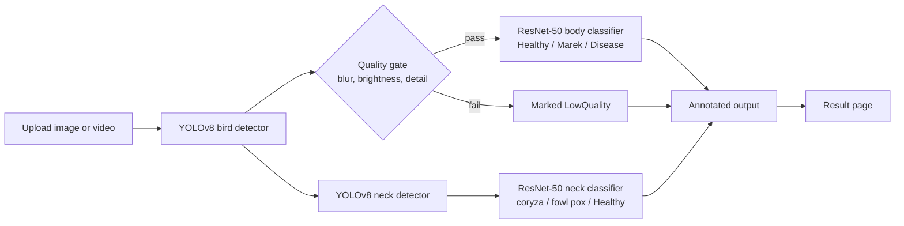

# CHARM: Chicken Health Assessment and Remote Monitoring

[](https://github.com/mr-taha-saqib/charm-poultry-health-monitoring/actions/workflows/ci.yml)


**CHARM** (Chicken Health Assessment and Remote Monitoring) is an AI-powered web based platform for the real-time detection and diagnosis of poultry diseases using deep learning and computer vision advanced algorithms. CHARM helps poultry farmers, veterinarians, and researchers upload images or videos of chickens to get instant diagnostic results, health alerts, and actionable treatment suggestions. The system is designed for practical deployment in poultry farms and aims to improve productivity, food safety, and animal health through rapid, automated diagnosis.

---

## Table of Contents

- [Project Overview](#project-overview)
- [Features](#features)
- [Tech Stack](#tech-stack)
- [System Architecture](#system-architecture)
- [Repository Layout](#repository-layout)
- [Getting Started](#getting-started)
- [Usage](#usage)
- [Tests](#tests)
- [Screenshots](#screenshots)
- [Contributing](#contributing)
- [License](#license)
- [Authors](#authors)

---

## Project Overview

Poultry farmers often struggle with early detection of infectious diseases, leading to rapid outbreaks and significant economic losses. **CHARM** leverages advanced AI—combining YOLOv8 object detection, BoT-SORT tracking, and ResNet50 classification—to analyze images and video footage, detect symptoms, classify diseases (Marek's disease, infectious coryza and fowl pox), and return an annotated image or video. Everything runs behind a simple Django web interface.

---

## Features

- **Image and video analysis**: upload a photo or a clip and get back an annotated copy.
- **Two-stage detection**: YOLOv8 finds each bird, a second YOLOv8 model finds the neck region.
- **Disease classification**: ResNet-50 labels each bird as *Healthy*, *Marek's* or *Diseased*; a second ResNet-50 checks the neck for *infectious coryza* and *fowl pox*.
- **Quality gate**: blurry, too dark, too bright or low-detail crops are skipped instead of misclassified.
- **Tracking in video**: BoT-SORT keeps a stable ID per bird and keeps the best-quality prediction for it.
- **Parallel inference**: classification runs in a thread pool so video tracking stays smooth.

---

## Tech Stack

- **Web**: Python, Django 5, Django templates, SQLite (PostgreSQL optional)
- **Detection and tracking**: Ultralytics YOLOv8, BoT-SORT
- **Classification**: PyTorch, torchvision ResNet-50
- **Image processing**: OpenCV, NumPy

---

## System Architecture



- **Detection**: YOLOv8 localizes each bird, and a second YOLOv8 model finds neck regions inside it.
- **Tracking** (video): BoT-SORT assigns stable IDs; each bird keeps its best-quality prediction.
- **Classification**: two ResNet-50 models label the body and neck crops that pass the quality gate.
- **Web app**: Django handles uploads, stores each upload and its result, and serves the result page.

---

## Repository Layout

```
webapp/                 Django project
  home/detection.py     Detection, tracking, quality gate and classification pipeline
  home/views.py         Upload, result, contact and page views
  home/tests.py         Test suite (runs without the models)
  myproj/settings.py    Settings, configured through environment variables
  templates/, static/   Pages and images
notebooks/
  model_training.ipynb       ResNet-50 training
  detection_pipeline.ipynb   Pipeline development and experiments
```

---

## Getting Started

### Prerequisites

- Python 3.10+
- A CUDA GPU is optional; CPU works for images, video is slow without a GPU.

### Installation

```bash
git clone https://github.com/mr-taha-saqib/charm-poultry-health-monitoring.git
cd charm-poultry-health-monitoring/webapp
pip install -r requirements.txt
python manage.py migrate
python manage.py runserver
```

### Model weights

The trained weights are not stored in this repository. Put the four files in `webapp/models/` (or point `CHARM_MODEL_DIR` at another folder):

| File | Model |
|---|---|
| `yolo_body.pt` | YOLOv8 whole-bird detector |
| `yolo_neck.pt` | YOLOv8 neck-region detector |
| `resnet50_body.pth` | ResNet-50 body classifier (Marek, Disease, Healthy) |
| `resnet50_neck.pth` | ResNet-50 neck classifier (infectious coryza, fowl pox, Healthy) |

The models load on the first upload, so the site itself starts without them.

### Configuration

| Variable | Default | Purpose |
|---|---|---|
| `DJANGO_SECRET_KEY` | development key | Set a real key in production |
| `DJANGO_DEBUG` | `1` | Set to `0` in production |
| `DJANGO_ALLOWED_HOSTS` | `localhost,127.0.0.1` | Comma-separated host names |
| `POSTGRES_DB`, `POSTGRES_USER`, `POSTGRES_PASSWORD`, `POSTGRES_HOST`, `POSTGRES_PORT` | unset (SQLite) | Use PostgreSQL instead of SQLite |
| `CHARM_MODEL_DIR` | `webapp/models` | Folder containing the model weights |

---

## Usage

1. Open `http://localhost:8000` and go to **Upload**.
2. Choose a photo (`.jpg`, `.png`) or video (`.mp4`, `.avi`, `.mov`) of your flock.
3. The result page shows the original next to the annotated output, with one box per bird, its label and an image-quality score.

---

## Tests

```bash
cd webapp
pip install -r requirements-test.txt
python manage.py test home
```

The suite covers every page, contact-form storage, the upload flow (success, oversized file, missing file, pipeline failure), the result page's media URLs, the image-quality gate, and the error raised when model weights are missing. Uploads are processed by a stub, so the tests need neither PyTorch nor the weights. CI runs them on every push.

---

## Screenshots


---

## Contributing

We welcome contributions!  
To contribute in our project:

1. Fork this repository.
2. Create a new branch.
3. Make your changes.
4. Submit a pull request with a clear description.

For major changes, please open an issue first to discuss what you would like to change.

---

## License

Released under the MIT License. See [LICENSE](LICENSE).

---

## Authors

- Muhammad Taha Saqib
- Tayyab Akhtar
- Mateen Abid

**Supervisor:** Ms. Sana Fatima  
*National University of Computer and Emerging Sciences, Lahore*

---

## Acknowledgments

- All open-source contributors and community resources referenced in the making of this project.
- Special thanks to our supervisor for guidance and support.

---

## Contact

For queries or collaboration, please open an issue or contact the authors directly.

